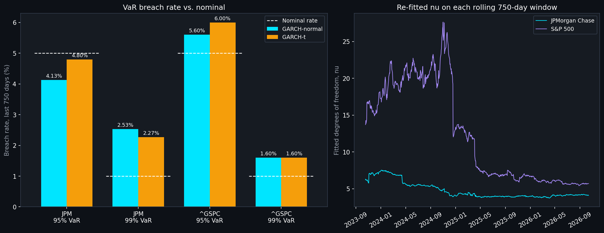
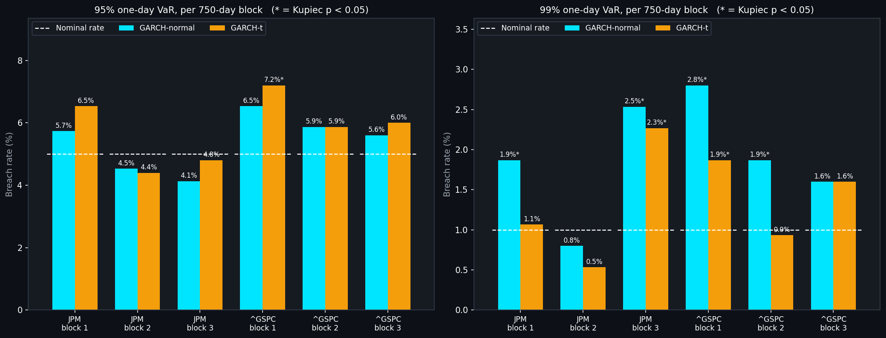
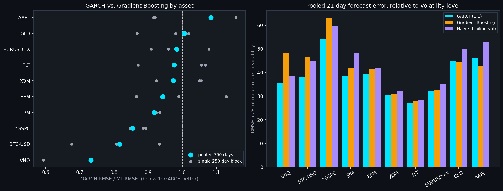
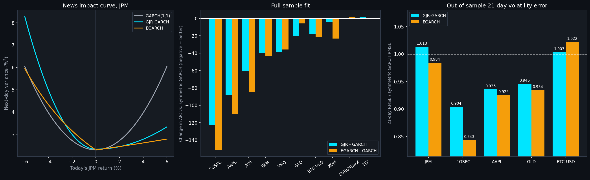
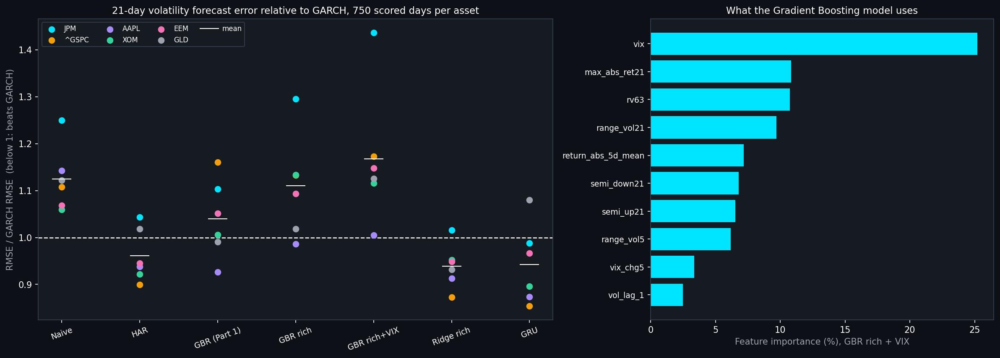
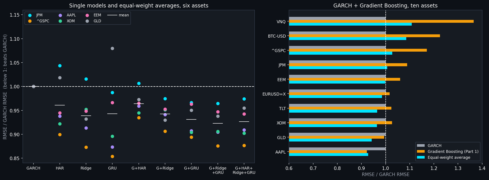

# Volatility Forecasting: GARCH vs Machine Learning
### Built on Real Market Data
**Ramith Vaid | NTU Singapore | Data Science & Artificial Intelligence**

> **Correction added 2026-10-20, after Part 4.** The forward realized-volatility target used by the original notebook and Part 1 covers days t+21 to t+41, not the next 21 days (t+1 to t+21) its description says: `compute_forward_realized_vol` applies a second shift after `rolling(h).std()` had already looked forward. GARCH's forecast of days t+1 to t+21 was therefore scored against a window that starts 20 days later, and the ML model was trained on a target that was one month stale. Part 4 uses the corrected target and re-runs Part 1's comparison: GARCH still has the lower error on both tickers, but by less (GARCH/ML RMSE ratio 0.87 to 0.93 on JPM, 0.74 to 0.89 on the S&P 500). The Part 1 text below is unchanged and its RMSE figures (4.17 vs. 4.82, 3.47 vs. 4.70) are the ones produced by the misaligned target. The VaR results (Parts 1 to 3) use returns only and are not affected.

---

## Overview

Volatility forecasting sits at the core of risk management, options pricing, and portfolio construction at any bank or trading desk. This project builds and rigorously compares two approaches to forecasting volatility on real market data:

1. **GARCH(1,1)**, the industry standard econometric model for volatility clustering, implemented from scratch via Maximum Likelihood Estimation, validated against simulated data with known parameters before being applied to real prices
2. **A machine learning alternative** (Gradient Boosting), using lagged realized volatility and return features

Both forecasts are evaluated out-of-sample against actual realized volatility, and the GARCH model is used to compute a Value at Risk (VaR) estimate, properly backtested for breach frequency, the same basic validation real risk teams run on their own models.

**Data:** JPMorgan Chase (JPM) and the S&P 500 (^GSPC), 2014-2024, via Yahoo Finance.

---

## A Methodological Issue Worth Documenting

An early version of this comparison produced a result that looked too good to be true: the ML model beat GARCH by close to 10x on RMSE. Rather than report that number, it was investigated properly.

The cause was a subtle but real data leakage problem. The original evaluation target, tomorrow's 21-day trailing realized volatility, overlapped with the ML model's own lagged input feature (yesterday's 21-day trailing realized volatility) on 20 of their 21 underlying days. The two values were correlated at roughly 0.97 purely from that overlap, regardless of any genuine predictive relationship, meaning the ML model's apparent accuracy was largely an artifact of being handed a near-copy of the answer.

The fix: both models were re-evaluated against a genuinely forward-looking, non-overlapping target, realized volatility over the next 21 days starting tomorrow, computed only from data not yet seen by either model. GARCH was extended to forecast its own 21-day-ahead average variance (the standard GARCH variance term structure) rather than a single one-day-ahead number, so both models are judged on the same, fairly defined task. After the fix, GARCH and ML RMSE came out close (9.86 vs 8.46), a believable, modest gap rather than an implausible one.

A second, smaller issue surfaced once the first was fixed: the Value at Risk section was then using the smoothed 21-day average forecast for what should be a sharp, single-day risk estimate. This was fixed by having the rolling GARCH function output both a true 1-day-ahead forecast and the 21-day average forecast from the same fitted model, since both come from the same parameters at effectively no extra computational cost, and using the correct one for each purpose.

This is included here deliberately. Catching a result that looks suspiciously good, diagnosing why, and fixing the underlying methodology rather than reporting a misleading number is a real and recurring part of applied data science work.

---

## GARCH(1,1) Implemented from Scratch

Rather than rely on a packaged library, GARCH(1,1) is implemented directly via Maximum Likelihood Estimation using `scipy.optimize`. This was a practical necessity as much as a design choice: the standard `arch` package has no prebuilt wheel for Windows on ARM, and compiling it from source requires a full Visual Studio build toolchain. Implementing the model directly avoided that dependency entirely.

The implementation is validated before being trusted on real data: a return series is simulated from known GARCH(1,1) parameters (omega=0.05, alpha=0.10, beta=0.85), and the fitting procedure is confirmed to recover those parameters closely (fitted: omega=0.0871, alpha=0.1006, beta=0.8024) before being applied to JPMorgan Chase and S&P 500 price data.

---

## Methodology

**Returns and realized volatility.** Daily log returns are computed from closing prices. Realized volatility is the rolling 21-day standard deviation of returns, annualized.

**GARCH(1,1) fitting.** Fit via MLE, refitting on a rolling basis across the out-of-sample test window. The fitted parameters feed a variance term structure: a one-step-ahead forecast using the last known return and variance, then each subsequent day forecast using the property that expected future squared returns equal the forecast variance itself, the standard technique for multi-day-ahead GARCH forecasts.

**Machine learning model.** Gradient Boosting trained on lagged realized volatility, lagged returns, and short-window return statistics, predicting a non-overlapping, forward-looking 21-day realized volatility target.

**Value at Risk backtesting.** A 95% one-day VaR threshold is computed from the GARCH model's true one-day-ahead forecast, then backtested: if well calibrated, actual daily losses should exceed the threshold roughly 5% of the time.

---

## Key Findings

**GARCH and ML perform comparably once evaluated fairly.** GARCH RMSE of 9.86 percentage points versus ML RMSE of 8.46, a modest, believable gap consistent with general findings in volatility forecasting research, rather than the artifact-driven 10x gap seen before the leakage was caught and fixed.

**The VaR model is conservative.** Backtested breach rate of 2.87% against an expected 5% for a 95% VaR threshold, meaning the model under-predicts risk slightly, fewer large losses occurred than the threshold implied should happen. This is a common, real characteristic of GARCH-based VaR models in practice, and is reported honestly rather than adjusted to look more precisely calibrated than it is.

---

## Known Limitations

**Single ticker depth.** The full GARCH-vs-ML comparison and VaR backtest were run in depth on JPMorgan Chase specifically; the S&P 500 data was collected and processed but not carried through the full rolling forecast pipeline. Extending the full comparison to the index, and to other individual stocks, is a natural next step.

**Normal innovations assumption.** The GARCH likelihood in the original and Part 1 runs assumes normally distributed return shocks. Part 2 implements Student-t innovations and compares the two (see below): the t model fits far better, but it does not fix the 99% VaR under-coverage, so the remaining gap is not just tail shape. Asymmetric (leverage) effects are tried in Part 5, where they do not fix the 99% VaR shortfall either; skewed innovations were not tried.

**VaR backtesting depth.** The original Kupiec-style check used one 209-day out-of-sample period, and Part 2 extended it to a single 750-day window. Part 3 repeats the backtest on three non-overlapping 750-day blocks (October 2017 to October 2026, including the COVID crash), which settles the "single calm window" concern, but it is still only three blocks, two tickers and one rolling-window design (a 750-day refit window, zero-mean returns, GARCH(1,1) only). With 24 block-level tests, about one rejection is expected by chance, and the blocks share training data at their edges. 213 early days could not be scored because the first test day needs 750 days of training data behind it.

---

## Part 1: Extended Date Range and Completed S&P 500 Comparison

The original run covered 2014 to 2024 and left the S&P 500 side of the comparison for future work. This extends both tickers through October 2026 and completes that comparison.

With two more years of data, GARCH now outperforms the ML model on both tickers, a reversal from the original finding (GARCH RMSE 9.86 vs ML RMSE 8.46 at the time):

| Ticker | GARCH RMSE | ML RMSE |
|---|---|---|
| JPM | 4.17 | 4.82 |
| S&P 500 | 3.47 | 4.70 |

Error on JPM roughly halved, from the original ~9-10 RMSE range down to ~4-5. The 250-day test window now falls in a comparatively calm stretch (October 2025 to October 2026), which plausibly explains part of the drop rather than a change in either model's underlying accuracy -- a reminder that a single out-of-sample window reflects the period it happens to cover.

VaR calibration also moved closer to target: 10 breaches in 209 test days (4.78%), close to the 5% nominal rate, versus 2.87% (noticeably over-conservative) in the original run.

The leakage check still holds at the extended range: lag-1 realized volatility correlates with the forward realized-vol target at 0.26 (JPM) and 0.22 (S&P 500), both well below the ~0.97 threshold that would indicate a leak.

---

## Part 2: Student-t Innovations vs. Normal Innovations

Part 1 flagged the normal-innovations assumption as a limitation. This replaces it with Student-t innovations (scaled to unit variance, so the conditional variance keeps its meaning and only the tail shape changes) and compares the two on fit and on VaR coverage. The model is GARCH(1,1) estimated by maximum likelihood, as before, with one extra parameter, the degrees of freedom `nu`. The implementation is in `garch_utils.py`; `part2_student_t.ipynb` runs the comparison with the data end date pinned to 2026-10-13 so it reproduces.

**Fit: the t model is overwhelmingly preferred.** Full-sample estimates on 3,213 daily returns each (2014-2026):

| | JPM normal | JPM t | S&P 500 normal | S&P 500 t |
|---|---|---|---|---|
| Log-likelihood | -5,728.5 | -5,565.9 | -4,089.8 | -3,993.3 |
| AIC | 11,463.1 | 11,139.7 | 8,185.5 | 7,994.5 |
| BIC | 11,481.3 | 11,164.0 | 8,203.8 | 8,018.8 |
| Fitted `nu` | n/a | 4.7 | n/a | 5.8 |

The likelihood-ratio statistics are 325 (JPM) and 193 (S&P 500), and both AIC and BIC prefer the t model on both tickers by a wide margin. Fitted degrees of freedom of about 5 mean tails far heavier than normal; under the normal fit the standardized residuals still have an excess kurtosis of 4.4 (JPM) and 2.4 (S&P 500) where a normal would have 0. Out of sample, the t model also forecasts the one-day-ahead distribution better: mean log predictive likelihood is higher by 0.085 per day on JPM and 0.029 on the S&P 500 over the 750-day test window, with the t model better on about 60% of days (naive t-statistics 2.2 and 2.7; these ignore autocorrelation, so treat them as indicative).

**VaR coverage: a better-fitting distribution did not translate into clearly better VaR.** Rolling one-day VaR, both models refit every day on the previous 750 days (as in Part 1), scored over the last 750 trading days (October 2023 to October 2026). Part 1's 250-day window would give only about 2.5 expected breaches at 99%, too few for a coverage test to mean much, so the longer window is the headline here:

| Ticker | Level | Expected | Normal breaches (Kupiec p) | t breaches (Kupiec p) |
|---|---|---|---|---|
| JPM | 95% | 37.5 | 31 (0.26) | 36 (0.80) |
| JPM | 99% | 7.5 | 19 (<0.001) | 17 (0.003) |
| S&P 500 | 95% | 37.5 | 42 (0.46) | 45 (0.22) |
| S&P 500 | 99% | 7.5 | 12 (0.13) | 12 (0.13) |

- **At 95% neither model is rejected on either ticker.** The t model is closer to nominal on JPM (4.80% vs 4.13%) and slightly further on the S&P 500 (6.00% vs 5.60%). On the most recent 250 days alone the t model breaches more at 95% (JPM 16 vs 11, S&P 500 17 vs 14), though none of these differences is statistically distinguishable.
- **At 99% both models under-cover on JPM** (2.5% and 2.3% breach rates against 1% nominal, both rejected by the Kupiec test, and by the conditional-coverage test, p = 0.002 and 0.008). Moving to t barely changes this, and on the S&P 500 the two models have the same number of breaches (12) at 99%.
- **Why the t model moves the needle so little.** With a fitted `nu` of about 4 on JPM, the unit-variance t quantile is only about 14% above the normal's at 99% (2.64 vs 2.33) and about 7% *below* it at 95%, so the t model widens the extreme tail a little and narrows the middle of it. That tail shape was not the main problem. The breaches look more like days when realized volatility exceeded the one-day forecast, which a different innovation distribution does not address. This reading is a hypothesis; it was not tested here.
- **Breaches are not clustered:** the Christoffersen independence test does not reject for any model, ticker or level (smallest p = 0.14).

So the honest summary is that Student-t is clearly the right likelihood for these returns (it fits far better, in sample and out of sample), but for the specific job of one-day VaR over this window it is roughly a wash against normal. The original and Part 1 normal-GARCH VaR results are therefore not undermined by the normality assumption; the 99% shortfall on JPM is real under both. Differences of a few breaches here are within sampling noise, and the window is a single, mostly calm period. Part 3 (below) repeats the backtest on three non-overlapping windows and qualifies this conclusion: the t model's 99% advantage is real in the earlier, more volatile windows and absent in this one.

---

## Part 3: Multi-Window VaR Backtest

Part 2 scored both models on one 750-day window (October 2023 to October 2026), and said itself that it was a single, mostly calm period. This repeats the same backtest on **three non-overlapping 750-day blocks** plus a pooled test, with the same models, the same rolling 750-day refits, the same Kupiec and Christoffersen tests, both tickers, both levels. The new helpers (`block_slices`, `var_hits`, `coverage_row`) are appended to `garch_utils.py`; `part3_multiwindow_var.ipynb` runs it with the data end date pinned to 2026-10-13.

**How the blocks are sized, and why.** The original plan was several windows in place of a single 209-day window, but 209 or 250 days expects only about 2 to 2.5 breaches at 99%, too few for a coverage test (that is why Part 2 moved to 750). So each block keeps Part 2's 750 days (37.5 expected breaches at 95%, 7.5 at 99%), and the blocks are laid end to end aligned to the end of the data, so the newest block is exactly Part 2's window. The notebook checks that it reproduces Part 2's breach counts and Kupiec p-values (it does, identically). The data has 3,213 returns and every daily refit needs 750 days of training data, leaving 2,463 scoreable days: room for three 750-day blocks (2,250 days) rather than four shorter ones with about 6 expected breaches at 99%. The pooled 2,250 days expect 112.5 breaches at 95% and 22.5 at 99%.

| Block | Dates | JPM realized vol (annualized) | S&P 500 realized vol | Worst day (JPM / S&P 500) |
|---|---|---|---|---|
| 1 | 2017-10-30 to 2020-10-21 | 34.31% | 23.25% | -16.21% / -12.77% |
| 2 | 2020-10-22 to 2023-10-16 | 26.20% | 17.84% | -6.34% / -4.42% |
| 3 (Part 2's window) | 2023-10-17 to 2026-10-13 | 23.13% | 14.94% | -7.78% / -6.16% |

**99% VaR: breaches per block against 7.5 expected, normal / t (Kupiec p in brackets).**

| Ticker | Block 1 | Block 2 | Block 3 | Pooled (22.5 expected) |
|---|---|---|---|---|
| JPM | 14 (0.033) / 8 (0.86) | 6 (0.57) / 4 (0.16) | 19 (<0.001) / 17 (0.003) | 39 (0.0015) / 29 (0.19) |
| S&P 500 | 21 (<0.001) / 14 (0.033) | 14 (0.033) / 7 (0.85) | 12 (0.13) / 12 (0.13) | 47 (<0.0001) / 33 (0.038) |

**95% VaR: breaches per block against 37.5 expected, normal / t (Kupiec p in brackets).**

| Ticker | Block 1 | Block 2 | Block 3 | Pooled (112.5 expected) |
|---|---|---|---|---|
| JPM | 43 (0.37) / 49 (0.065) | 34 (0.55) / 33 (0.44) | 31 (0.26) / 36 (0.80) | 108 (0.66) / 118 (0.60) |
| S&P 500 | 49 (0.065) / 54 (0.009) | 44 (0.29) / 44 (0.29) | 42 (0.46) / 45 (0.22) | 135 (0.035) / 143 (0.005) |

**What the extra windows change about Part 2's conclusions.**

- **Part 2's "Student-t is roughly a wash for VaR" holds only for its own window.** At 99% the t model beats normal in the two earlier blocks on both tickers (JPM block 1: 8 breaches against 14, with the t model passing Kupiec and the normal model failing; S&P 500 block 1: 14 against 21; S&P 500 block 2: 7 against 14), and pooled over all 2,250 days the JPM t model is not rejected (29 breaches vs 22.5 expected, p = 0.19) while the normal model is (39, p = 0.0015). The S&P 500 t model is still rejected pooled at 99% (33, p = 0.038), but much less badly than normal (47, p < 0.0001). Block 3, which is Part 2's window, is the one block where t does almost nothing (JPM 17 vs 19, S&P 500 12 vs 12). So the heavier-tailed likelihood does matter at 99% in volatile periods; Part 2's window just happened not to show it.
- **Part 2's "the 99% shortfall on JPM is real under both" is concentrated in the most recent block.** JPM's t model covers 99% in blocks 1 and 2 (8 and 4 breaches against 7.5 expected), and the normal model passes block 2. The block with the most JPM breaches (19 normal, 17 t) is block 3, the lowest-volatility block by realized volatility, and those 17 t-model breaches are spread across 2023 to 2026 rather than clustered (Christoffersen independence p = 0.40), nine of them beyond 3 forecast standard deviations, the largest 6.6 (-6.69% on 2024-04-12 against a forecast daily volatility of about 1.0%). This is a description of where the breaches are, not a diagnosis of why.
- **At 95%, the t model is not better, and the S&P 500 is over-breached throughout.** The t model breaches more than normal at 95% in most blocks (the t quantile is narrower than the normal at that level). On the S&P 500 both models are above 5% in all three blocks (normal 6.53%, 5.87%, 5.60%; t 7.20%, 5.87%, 6.00%), and pooled both are rejected (normal 6.00%, p = 0.035; t 6.36%, p = 0.005). Part 2's "neither model is rejected at 95% on either ticker" was true of its window only. JPM at 95% passes every block and the pooled test for both models (pooled 4.80% normal, 5.24% t).
- **Breaches were not clustered in Part 2's window, but they were in block 1.** The Christoffersen independence test rejects only in block 1 at 95% (JPM normal p = 0.010, JPM t p = 0.013, S&P 500 normal p = 0.013, S&P 500 t p = 0.045), the block that contains the 2020 crash; elsewhere it does not reject (smallest p there is 0.07).

**Multiple testing.** There are 24 block-level Kupiec tests (2 tickers x 2 levels x 2 models x 3 blocks), so about 1.2 rejections are expected at the 5% level even if every model were perfect. Seven reject, and two survive a Holm adjustment across all 24: the normal model at 99% on JPM in block 3 (adjusted p = 0.009) and on the S&P 500 in block 1 (adjusted p = 0.001). The t model's rejections (JPM 99% block 3, S&P 500 99% block 1, S&P 500 95% block 1, among others) do not survive that adjustment individually, so the strongest, least-fragile statement is about the normal model at 99%, not about t.

**Part 2 left one explanation untested; Part 3 tests it, and it does not hold up.** Part 2 suggested the 99% breaches looked like days when realized volatility exceeded the one-day forecast. If a model's one-day sigma is right on average, the standard deviation of `return / sigma` is about 1. It is 1.082 (normal) and 1.024 (t) for JPM in block 1, and 1.081 and 1.041 for the S&P 500, so in the crash block the normal model under-forecast the size of moves, and the t model much less so. In blocks 2 and 3 it is between 0.99 and 1.03 for every model and ticker, including JPM in block 3 (1.030 for both), where the breaches are most numerous. So an under-forecast of the volatility level fits block 1 but does not explain JPM's block 3 breaches; those look like individual large days, which a one-day-ahead GARCH-t distribution still treats as too unlikely. That is consistent with the data but not itself tested.

---

## Part 4: Does GARCH Over ML Generalize?

Part 1 compared GARCH(1,1) with a Gradient Boosting model on two US equity series and one 250-day window. Part 4 repeats the comparison on ten assets and three non-overlapping windows each, and corrects the forward target (see the note at the top). The assets are JPM, the S&P 500, Apple, Exxon, emerging-market equities (EEM), REITs (VNQ), gold (GLD), long Treasuries (TLT), EUR/USD and Bitcoin. For each, the last 750 days with a complete 21-day forward window are split into three 250-day blocks (September 2023 to September 2026 for most assets; Bitcoin trades every day, so its 750 days start in September 2024). GARCH is refit every day on the trailing 750 returns, with the forecast made at the close of day t from data through day t. One Gradient Boosting model (Part 1's settings) is trained per block on rows whose forward window ends before the block starts, instead of Part 1's split, which trained on 21 rows whose targets reached into the test period. A naive forecast (the trailing 21-day realized volatility) is included as a reference. Losses are compared with a Diebold-Mariano test using 20 Newey-West lags because consecutive 21-day targets overlap. Every GARCH refit is checked against a constant-variance model, which GARCH nests, and none of the 7,500 fits failed that check.

**The corrected target narrows Part 1's gap but does not reverse it.** Part 1's two comparisons, re-run three ways (RMSE in annualized percentage points, GARCH / ML, with their ratio):

| | Part 1 as published | Corrected target | Corrected target and embargo |
|---|---|---|---|
| JPM | 4.17 / 4.82 (0.87) | 4.08 / 4.35 (0.94) | 4.08 / 4.37 (0.93) |
| S&P 500 | 3.47 / 4.70 (0.74) | 3.37 / 3.87 (0.87) | 3.37 / 3.78 (0.89) |

**Across ten assets, GARCH is usually ahead, by a modest and mostly not statistically clear margin.** GARCH has the lowest RMSE in 18 of the 30 asset-blocks, the ML model in 8 and the naive forecast in 4. GARCH beats ML in 20 of 30 asset-blocks and on 8 of 10 assets pooled; ML is ahead on Apple (GARCH/ML RMSE ratio 1.08) and on gold (1.01). Pooled ratios run from 0.73 (REITs) to 1.08 (Apple): 0.85 for the S&P 500, 0.82 for Bitcoin, 0.92 for JPM, 0.94 for emerging-market equities, and between 0.97 and 0.98 for Exxon, long Treasuries and EUR/USD. The Diebold-Mariano test separates GARCH from ML on one asset only, Bitcoin (p < 0.001); on the other nine the p-values are between 0.19 and 0.91. GARCH beats the naive forecast on all ten assets pooled, while the ML model beats it on seven. All the forecasts are noisy: pooled RMSE is 27% to 54% of the mean realized volatility for GARCH.

**The lead is not stable over time.** The median GARCH/ML ratio across the ten assets is 0.92 in the oldest block, 0.89 in the middle one and 1.00 in the most recent, where the lowest RMSE goes to GARCH on four assets, to ML on four and to the naive forecast on two. Part 1's conclusion that GARCH beats ML was drawn from one recent window, so this is the window where the two are closest.

## Part 5: Leverage Effects (GJR-GARCH and EGARCH)

The symmetric GARCH(1,1) treats a 3% fall and a 3% rise as equally informative about tomorrow's volatility. Part 5 adds two asymmetric models, fit by maximum likelihood with normal innovations like the symmetric one so that only the variance equation changes: GJR-GARCH, `sigma2_t = omega + (alpha + gamma * 1[r_{t-1} < 0]) r_{t-1}^2 + beta sigma2_{t-1}`, and EGARCH, `ln sigma2_t = omega + beta ln sigma2_{t-1} + alpha (|z_{t-1}| - E|z|) + gamma z_{t-1}`. EGARCH's multi-day variance forecast uses the exact expectation of the exponentiated shocks (checked against a Monte Carlo simulation), not only the expectation of the log variance. The functions are in `garch_utils.py` and `part5_leverage.ipynb` runs the comparison on the ten Part 4 assets (full-sample fits) and on five of them out of sample (JPM, the S&P 500, Apple, gold and Bitcoin, over the same 750 scored days as Part 4, all models refit daily on the trailing 750 returns). No refit failed the constant-variance check described in Part 4.

**The leverage effect is strong in US equities and absent or reversed elsewhere.** After a down day the next day's absolute return is on average 1.29 times that after an up day for the S&P 500, and 1.15 to 1.17 for JPM, Apple and REITs, but 0.96 for gold, 1.00 for long Treasuries and 0.97 for EUR/USD. In the full-sample GJR fit, `gamma` is positive with a likelihood-ratio p-value below 0.001 for JPM (0.137), the S&P 500 (0.241), Apple (0.162), emerging-market equities (0.112) and REITs (0.099), weak for Exxon (0.030, p = 0.011), and not significant for long Treasuries (p = 0.40) and EUR/USD (p = 0.11). Gold has the opposite sign (-0.046, p < 0.001: rises raise volatility more than falls). Bitcoin looks asymmetric under normal innovations (p < 0.001) but not once the innovations are Student-t (p = 0.73), so there the apparent asymmetry comes from fat tails. By AIC, GJR beats the symmetric model on 9 of 10 assets (all but long Treasuries) and EGARCH on 8 of 10; EGARCH has the lowest AIC on six (JPM, the S&P 500, Apple, Exxon, emerging markets, Bitcoin) and GJR on REITs and gold. The improvement is large for the S&P 500 (AIC lower by 123 for GJR and 151 for EGARCH) and JPM (61 and 85). Next-day variance after a -3% day is 2.67 times that after a +3% day for the S&P 500 under GJR (2.57 under EGARCH) and 1.48 times for JPM (1.46), where the symmetric model gives 1.00. The fitted `gamma` has the same sign in every daily refit for JPM, the S&P 500, Apple and gold (GJR means 0.17, 0.15, 0.12 and -0.09).

**Out of sample the asymmetric models help a little, and not significantly.** The 21-day volatility forecast RMSE relative to the symmetric model (GJR / EGARCH) is 0.90 / 0.84 for the S&P 500, 0.94 / 0.93 for Apple, 0.95 / 0.93 for gold, 1.01 / 0.98 for JPM and 1.00 / 1.02 for Bitcoin. None of the Diebold-Mariano p-values is below 0.05 (the smallest is 0.089, S&P 500 GJR). For the one-day density, the mean log score is higher on the S&P 500 by 0.035 per day for GJR (t = 4.4) and 0.029 for EGARCH (t = 2.2), and within 0.016 on the other four assets (t up to 1.6). The asymmetry does not fix VaR coverage: at 99% JPM has 18 breaches under the symmetric model, 18 under GJR and 20 under EGARCH against 7.5 expected (all rejected, p <= 0.001), and on the S&P 500 EGARCH is worse than the symmetric model (16 breaches against 12, p = 0.007) while GJR is about level (13). At 95% the S&P 500 has 45, 36 and 31 breaches (none rejected), so the asymmetric models move the 95% rate toward nominal there. The JPM 99% shortfall in Parts 2 and 3 is therefore not a leverage effect.

## Part 6: Richer Features and a Sequence Model on the ML Side

Part 4 compared GARCH with the Part 1 machine learning model, Gradient Boosting on 12 lagged features. A better-built ML model might change the ranking, so Part 6 keeps the same design (aligned 21-day target, features through day t only, one model per block trained with the embargo, the same three 250-day blocks and scored days as Part 4) and varies the ML side on six assets: JPM, the S&P 500, Apple, Exxon, emerging-market equities and gold. A truncation test confirms every feature row at day t is unchanged when the data is cut off at day t, including the range and VIX features. The models are HAR (least squares on realized volatility over 5, 21 and 63 days), Gradient Boosting on four feature sets (Part 1's 12 features, those plus the HAR horizons, a rich set adding downside and upside semivolatility, the largest absolute return in 21 days and high-low range volatility, and the rich set plus the VIX level and its 5-day change), Ridge regression on the rich set, and a GRU over the last 42 days of return, absolute return, log high-low range and VIX. PyTorch is not available for this Python build, so the GRU is written in numpy (`NumpyGRU` in `garch_utils.py`, trained with Adam and backpropagation through time; its gradients match finite differences to 1.5e-7). Each block's GRU forecast is the average of three seeds, with 15% of the training sequences held out for early stopping.

**The ranking against GARCH depends on which ML model is used.** RMSE relative to GARCH, averaged over the six assets (below 1 beats GARCH):

| Model | Mean RMSE ratio to GARCH |
|---|---|
| Ridge on the rich features | 0.94 |
| GRU | 0.94 |
| HAR | 0.96 |
| Gradient Boosting, Part 1 features | 1.04 |
| Gradient Boosting, Part 1 features plus HAR horizons | 1.08 |
| Gradient Boosting, rich features | 1.11 |
| Gradient Boosting, rich features plus VIX | 1.17 |
| Naive (trailing 21-day volatility) | 1.13 |

The simple regularized models and the GRU are slightly ahead of GARCH on average, and the Gradient Boosting models are behind it, increasingly so as features are added. By asset, the GRU's ratio is 0.85 for the S&P 500, 0.87 for Apple, 0.90 for Exxon, 0.97 for emerging markets, 0.99 for JPM and 1.08 for gold; Ridge's is 0.87, 0.91, 0.95, 0.95, 1.02 and 0.93. Across the 18 asset-blocks the lowest RMSE goes to the GRU 6 times, GARCH 3, Ridge 3, HAR 2, Gradient Boosting on base plus HAR features 2, and the other two Gradient Boosting variants once each; Ridge and the GRU beat GARCH in 11 of 18 and HAR in 9.

**The evidence is weak.** Pooled Diebold-Mariano tests (Newey-West, 20 lags) of each model against GARCH find one significantly better pairing (HAR on Exxon, p = 0.025) and one significantly worse (Gradient Boosting on base plus HAR features on JPM, p = 0.031) out of 48; the GRU's smallest p-value is 0.062 (Exxon), and its other p-values are 0.135 to 0.803. So the supportable statement is that GARCH is not clearly better than a well-built ML model: Part 4's lead for GARCH was a lead over Gradient Boosting on lagged features, and simple linear models on the same kind of information, or a small recurrent network, are at least level with it.

**More features made Gradient Boosting worse.** VIX is the single most important feature in the rich-plus-VIX model (25% of the importance, followed by the largest 21-day absolute return, the 63-day volatility and the 21-day range volatility), yet adding it raised the RMSE ratio from 1.11 to 1.17, with the largest damage on JPM (1.30 to 1.44). The importance shows what the trees split on, not that the splits generalize. A plausible reason, not tested here, is that trees predict within the range of levels seen in training and the VIX and volatility levels in the test blocks differ from it. The linear models and the GRU, fed standardized inputs, do not have that limit.

## Part 7: Combining the GARCH and ML Forecasts

If GARCH and an ML model make different errors, their average can beat both. `part7_ensemble.ipynb` tests this with no new fitting, using the daily 21-day forecasts already produced by Parts 4 and 6 (same target, embargo, blocks and scored days; the two parts' targets agree to 0.00014 percentage points, the difference being revisions to adjusted prices between downloads). It looks at error correlation, equal-weight averages, and weights learned from the previous block (for blocks 2 and 3, a weight on GARCH chosen on a 0 to 1 grid to minimize last block's squared error, against the 50/50 average and an oracle weight chosen on the block itself).

**The errors are highly correlated, which limits what averaging can do.** The correlation between GARCH's forecast errors and an ML model's is 0.84 on average for the Part 1 Gradient Boosting model (0.77 to 0.91 across assets), 0.85 for the GRU, 0.90 for Ridge and 0.94 for HAR. Both kinds of model miss the same volatility shocks.

**Averaging with the Part 1 Gradient Boosting model leaves GARCH about where it was.** Over ten assets the 50/50 average has a mean RMSE ratio to GARCH of 1.001. It beats GARCH on 6 of 10 assets, the Gradient Boosting model on 9 and both on 5. It is better than GARCH by a visible margin on Apple (0.93), gold (0.94), long Treasuries (0.97) and Exxon (0.96), and worse on REITs (1.11) and Bitcoin (1.09); only Bitcoin is significant against GARCH (Diebold-Mariano p = 0.001, in the wrong direction). The average is significantly better than the Gradient Boosting model on gold (p = 0.019) and Bitcoin (p < 0.001).

**Averaging with the better ML models gives a lower error, but mostly because those models are individually better.** On the six Part 6 assets, mean RMSE ratio to GARCH: GARCH plus HAR 0.964, plus Ridge 0.943, plus the GRU 0.931, GARCH plus Ridge plus GRU 0.923, GARCH plus all three 0.927 and, with GARCH left out, HAR plus Ridge plus GRU 0.925. Those compare with 0.961, 0.939 and 0.943 for HAR, Ridge and the GRU alone. GARCH adds nothing once the ML models are averaged, and an ensemble beats the best of HAR, Ridge and the GRU on an asset in only 0 to 3 of the 6 assets (3 for the ML-only average). Of 54 Diebold-Mariano comparisons of an ensemble with a component, 7 have p < 0.05: ensembles including GARCH beat GARCH on Exxon (p between 0.004 and 0.029), the four-model average beats Ridge on Exxon (p = 0.016), and three ensembles beat the GRU on gold (p between 0.018 and 0.037). Nothing is significant on the other four assets.

**Weights learned from the past are worse than a fixed 50/50.** Averaged over asset-blocks, the RMSE is 7.80 for GARCH, 8.43 for the Part 1 Gradient Boosting model, 7.82 for the 50/50 average, 8.01 for the weights learned on the previous block and 7.53 for the oracle weight (20 asset-blocks). For the GRU (12 asset-blocks) the figures are 8.83, 8.41, 8.29, 8.59 and 8.00, and for Ridge 8.83, 8.37, 8.37, 8.55 and 8.20. The learned weight beats the 50/50 average in only 7 of 20, 3 of 12 and 4 of 12 asset-blocks, because the best weight on one block is a poor guide to the next (the average learned weight on GARCH is 0.71, 0.30 and 0.39, close to the oracle averages of 0.66, 0.37 and 0.39, but the block-to-block values are noisy). So the simple average is the version worth using, and the gain over the better single model is small.

---
## Files

- `volatility_forecasting.ipynb` -- the original JPM-only, 2014-2024 notebook, left untouched.
- `garch_utils.py` -- the GARCH(1,1), realized-volatility and ML-feature functions factored out of the original notebook (bodies unchanged), plus `run_full_pipeline()` to run the whole per-ticker comparison on any ticker or date range.
- `part1_extended_and_sp500.ipynb` -- Part 1: both tickers through October 2026, using `garch_utils.py`.
- `chart_extended_jpm_vs_sp500.png` -- GARCH vs. ML RMSE, JPM vs. S&P 500, extended period.
- `part2_student_t.ipynb` -- Part 2: Student-t vs. normal GARCH on fit and VaR coverage (the Student-t, Kupiec and Christoffersen functions were added to `garch_utils.py`).
- `chart_part2_student_t.png` -- VaR breach rates by model and the rolling fitted `nu`.
- `part2_fit_comparison.csv`, `part2_var_coverage.csv`, `part2_density_score.csv` -- the numbers behind the Part 2 tables.
- `part3_multiwindow_var.ipynb` -- Part 3: the VaR backtest on three non-overlapping 750-day blocks plus a pooled test (`block_slices`, `var_hits` and `coverage_row` were appended to `garch_utils.py`).
- `chart_part3_multiwindow.png` -- breach rate by block, normal vs. t, both tickers and levels.
- `part3_block_coverage.csv`, `part3_pooled_coverage.csv`, `part3_block_diagnostics.csv`, `part3_blocks.csv` -- the numbers behind the Part 3 tables.
- `part4_generalization.ipynb` -- Part 4: GARCH vs. Gradient Boosting on ten assets and three blocks each, with the corrected forward target (`compute_forward_realized_vol_aligned`, `prepare_vol_data`, `make_blocks`, `rolling_garch_term_structure`, `ml_block_forecast`, `dm_test` and a faster, identical GARCH fit were appended to `garch_utils.py`).
- `chart_part4_generalization.png` -- GARCH/ML RMSE ratio by asset and block, and pooled error relative to volatility level.
- `part4_part1_rerun.csv`, `part4_by_block.csv`, `part4_pooled.csv`, `part4_forecasts.csv` -- the numbers behind the Part 4 tables, and every daily forecast.
- `part5_leverage.ipynb` -- Part 5: GJR-GARCH and EGARCH against the symmetric GARCH(1,1), in sample on ten assets and out of sample on five (the GJR, EGARCH and news-impact functions were appended to `garch_utils.py`).
- `chart_part5_leverage.png` -- news impact curves, change in AIC by asset and out-of-sample 21-day error.
- `part5_leverage_descriptive.csv`, `part5_fit_comparison.csv`, `part5_oos_21day.csv`, `part5_oos_1day.csv`, `part5_rolling_gamma.csv` -- the numbers behind the Part 5 tables.
- `part6_ml_variants.ipynb` -- Part 6: HAR, Gradient Boosting on four feature sets, Ridge and a numpy GRU against GARCH on six assets (`build_rich_features`, `NumpyGRU` and `make_sequences` were appended to `garch_utils.py`).
- `chart_part6_ml_variants.png` -- RMSE relative to GARCH by model and asset, and feature importances.
- `part6_forecasts.csv`, `part6_rmse_pooled.csv`, `part6_rmse_ratio_to_garch.csv`, `part6_by_block.csv`, `part6_dm_tests.csv`, `part6_feature_importance.csv` -- the numbers behind the Part 6 tables, and every daily forecast.
- `part7_ensemble.ipynb` -- Part 7: error correlation, equal-weight ensembles and weights learned from the previous block, built from the Part 4 and Part 6 forecasts (no new fitting).
- `chart_part7_ensemble.png` -- single models and ensembles relative to GARCH.
- `part7_error_correlation.csv`, `part7_ensemble_ten_assets.csv`, `part7_ensemble_six_assets_rmse.csv`, `part7_ensemble_six_assets_ratio.csv`, `part7_ensemble_dm_tests.csv`, `part7_learned_weights.csv`, `part7_learned_weights_summary.csv` -- the numbers behind the Part 7 tables.

---

## Stack

- **Language:** Python 3.13
- **Libraries:** pandas, numpy, scipy, scikit-learn, yfinance, matplotlib
- **Data source:** Yahoo Finance (free, no API key required)
- **GARCH implementation:** custom, via scipy.optimize, no external GARCH package dependency

---

*Built by Ramith Vaid | NTU Singapore | ramithvaid@gmail.com*
